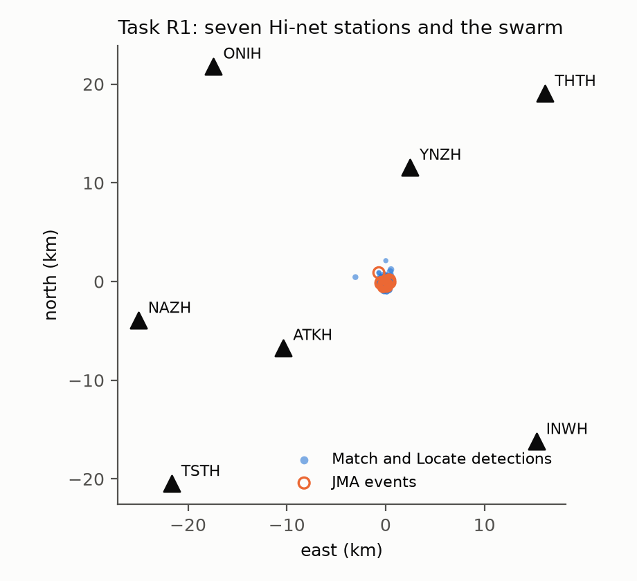
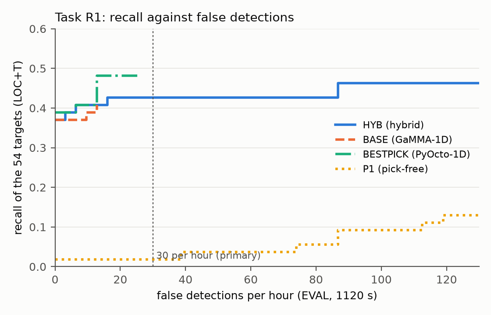
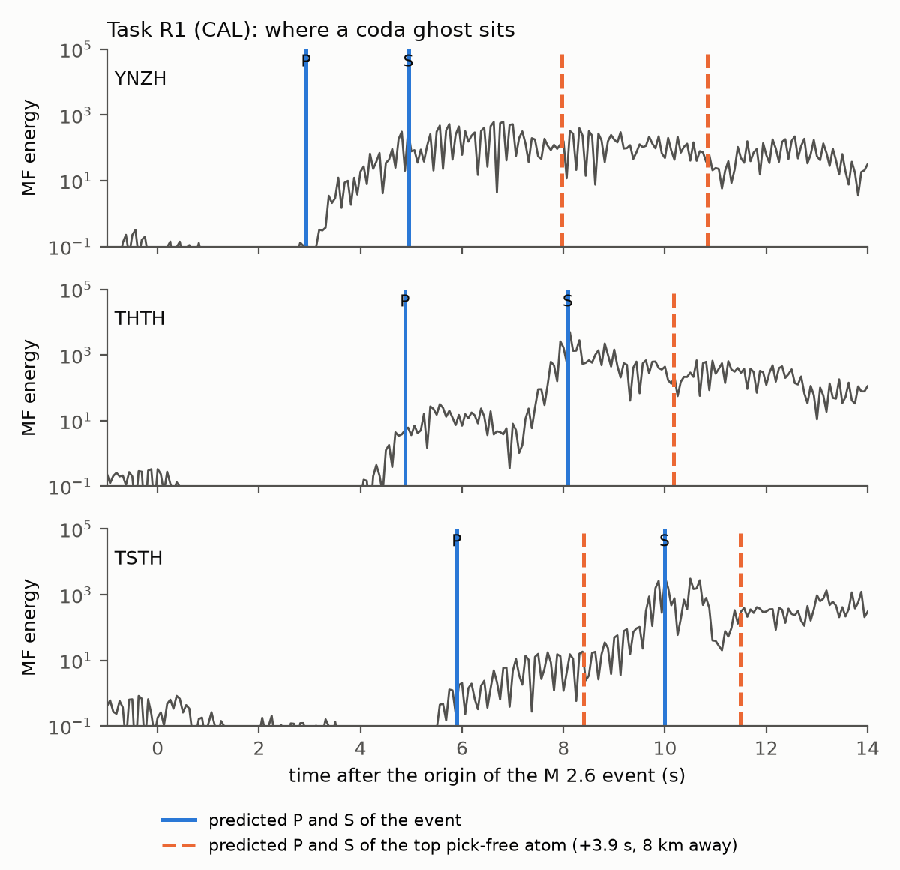

# Timing-Tolerant, Bounded-Influence Moment-Tensor Detection of Overlapping Earthquakes

**A preregistered benchmark, a bounded-influence statistic, and two registered tests on real data**

Universidad Icesi - Trabajo de grado - Juan Jose Gordillo Cordoba - October 2026

---

## Abstract

Earthquake catalogues are built by picking phase arrivals at each station and associating the picks into events.
In dense sequences, where several earthquakes overlap within seconds, picks are missed, merged or assigned to the
wrong event. This thesis asks whether a detector that skips picking can do better: it scans a grid of hypocentres and
origin times, reads the three-component matched-filter output at the predicted P and S times of every station
within a tolerance window, scores the readings against the subspace spanned by all moment tensors, and removes the
accepted events one by one (greedy deflation). Two further ideas are tested: bounding the influence of each station on
the score (a cap or a Huber fit), and estimating station travel-time terms without picks.

Every confirmatory test was registered before its run in an append-only log sealed by a hash chain (four of them
reused the windows of an earlier task); which tests also had a frozen code list, a single run and a verification by a
separate AI session is stated task by task in Table 3. On a synthetic benchmark with eight registered tasks the
timing-tolerant moment-tensor family exceeded GaMMA, PyOcto and QuakeMigrate fed by an STA/LTA picker, but block
orthogonal matching pursuit with the same timing tolerance matched the thesis detector, and an off-grid convex
variant was refuted. Capping each station added 0.04 to 0.07 in recall over the same detector without the cap in dense
synthetic sequences, and on one day of real noise with transients and injected synthetic events (Alto Tiberina, Italy)
the capped detector exceeded uncapped block pursuit by +0.228 [+0.148, +0.298] with the epicentre rule and +0.085 with
the origin time also required; block pursuit with the same cap recovers most of that gap, so the gain belongs to the
per-station bound. On real seismicity the
pick-free detector failed: on one hour of the 2019 Ridgecrest sequence it recalled at most 0.022 of the catalogued
events against up to 0.667 for PhaseNet with PyOcto, and on a 2012 swarm recorded by seven Hi-net stations it found 1
of 54 target events. A hybrid that adds pick-free candidates to a pick-based associator and scores them by the
PhaseNet picks they explain found 23 of 54 against 22 for the associator alone (exact McNemar p = 0.50), so no gain was
demonstrated. A short theory of the deployed statistic, written after the experiments, is consistent with both sides:
the cap bounds the effect of one station on the score by a constant and leaves the Gaussian false-alarm tail
unchanged, and it discards amplitude information once readings saturate, which is part of why it fails in continuous
seismicity. The diagnosis of the real-data failures (at Ridgecrest, timing errors of 0.35 to 0.41 s against a
tolerance of 0.25 s; on the swarm, a quarter or more of the readings off by more than 0.5 s,
S-dominated energy, coda ghosts after deflation) defines what a pick-free detector would need before it can compete
with modern pickers.

---

## 1. Introduction

### 1.1 The problem

A seismic catalogue lists, for every earthquake, an origin time, a hypocentre and a magnitude. Almost every catalogue
in operation is produced in two steps. A picker marks the arrival times of P and S waves at each station; modern
deep-learning pickers such as PhaseNet [11] do this far better than the classical short-term over long-term average
(STA/LTA) detectors. An associator then groups picks from different stations into events that are consistent with
travel times from a common source; GaMMA [3], PyOcto [7] and REAL [88] are widely used examples. The two-step design is
fast and accurate when events are well separated in time. It degrades when they are not: in an aftershock sequence
or a swarm, waves from several earthquakes overlap at each station, a picker may report one arrival where there are
two, and an associator must solve a combinatorial assignment problem with missing and spurious picks.

Waveform-based methods avoid the picking step. Migration and stacking methods such as QuakeMigrate [109] back-project
an energy function of the waveforms onto a grid of hypotheses; matched-filter and template methods correlate the data
with recordings of known events [15], [118], [137]; sparse moment-tensor inversion treats the data as a sum of a few
point sources drawn from a dictionary of Green's functions [129]-[131], [141]. Their common weakness is that they need
travel times to be predicted more accurately than the waveform period, and on real data they rarely are.

### 1.2 Research question

The question of this thesis is whether a pick-free detector that combines three ingredients can detect overlapping
earthquakes on sparse networks better than pick-based association:

1. the physics of the source: the readings at all stations must be explained by one moment tensor, a six-dimensional
   linear subspace of the multi-station data, which rejects combinations of arrivals that no single source could
   produce;
2. timing tolerance: each arrival is read at the largest matched-filter energy within a window around its predicted
   time, so that the score survives travel-time errors smaller than the window;
3. greedy deflation: the best-scoring event is accepted, its predicted contribution is subtracted from the data, and
   the search is repeated, so that overlapping events are found one at a time.

Two refinements were added during the work and became hypotheses of their own: bounding the influence of any single
station on the score, and estimating station travel-time terms without picks.

### 1.3 What this thesis claims

The contributions are the following, stated at the level the evidence supports.

1. **A preregistered benchmark and protocol.** Eleven registered tests of the method (eight on synthetic data, one on
   real noise with injected events, two on real seismicity), with exact FROC curves at a realized false-event rate and
   paired bootstrap intervals. Table 3 states, for each, whether its registration was hashed before the run, whether
   its code was frozen by a hash list, whether it was run once and whether it was verified; not all of them had every
   step. Positive and negative results are reported in the same way, and a register of fifty-seven
   errors found during the work is part of the record.
2. **Bounded influence helps in noise with transients.** A per-station cap or a Huber fit adds detections in
   dense sequences on synthetic data and on one day of real noise with transients and injected events, by a smaller
   amount when the origin time is also required; the gain belongs to the per-station bound
   and not to the particular pursuit, since block orthogonal matching pursuit with the same bound recovers almost all
   of it (a descriptive arm of Task 2F and exploration C18f). Propositions in Section 4, written after the
   experiments, bound the effect of one station on the score by a constant, show that the cap
   changes the Gaussian false-alarm tail by a negligible amount, and show that it discards amplitude information when readings
   saturate.
3. **Two registered negative results on real seismicity, with a measured diagnosis.** The pick-free detector fails on
   the 2019 Ridgecrest aftershock sequence and on a 2012 Hi-net swarm, and the causes are measured: travel-time errors
   larger than the reading tolerance, a capped score that saturates in continuous seismicity, S-wave energy that
   dominates the P reading at near stations, and ghost events left by imperfect deflation.
4. **A hybrid with pick-based association, tested once.** Adding pick-free candidates to a PhaseNet associator and
   scoring every candidate by the picks it explains did not add a demonstrable number of detections on unseen data.

It does not claim that pick-free moment-tensor detection beats modern pick-based association on real data; the two
real tests show the opposite. Nor does it claim that the detector of the thesis (MT-FW) is better than block
orthogonal matching pursuit with the same timing tolerance: a registered task found them equal.

### 1.4 How the thesis is organised

Section 2 places the method among existing ones. Section 3 describes the detector, the bounded-influence statistics,
the station terms and the hybrid. Section 4 states what can be proved about the deployed statistic. Section 5
describes the protocol: preregistration, metrics and decision rules, including a simulation that fixed the rules of
the last real test. Section 6 gives the results in one evidence table and then task by task. Section 7 discusses what
the evidence supports, why the pick-free detector fails on real data, and the threats to validity. Section 8
concludes. Section 9 explains how to reproduce every number, and Section 10 states what the candidate and the AI
tools each did. The full task-by-task record, with every table, is in
the evidence volume `docs/proposal/Supplementary_Evidence_Appendices_G_to_AA.md` (cited below as Appendix Y.n or
AA.n); an earlier, broader design document written in the format of a doctoral proposal is kept in
`docs/proposal/Doctoral_Proposal.md` as the record of the original plan.

---

## 2. Background and related work

**Pick-based association.** PhaseNet [11] is a U-Net trained on Northern California picks that returns, for each
sample, probabilities of P, S and noise; its picks are the input of most modern associators. GaMMA [3] models picks as
a Bayesian Gaussian mixture in time and space whose components are events; PyOcto [7] partitions space and time in an
octree and keeps the cells consistent with enough picks; REAL [88] counts picks on a grid. Learned associators such as
PhaseLink [5] and graph neural networks [6] exist but need training data from the region. All of them inherit the
errors of the picks: a missed pick cannot be recovered, and in dense sequences the assignment of picks to events is
ambiguous.

**Waveform migration and stacking.** QuakeMigrate [109] stacks onset functions of the waveforms along predicted
moveouts on a grid; back-projection stacking of P and S waves can include focal mechanism corrections [112], [122]. Such
methods are robust to missed picks but sensitive to the travel-time model, and their score adds evidence from all
stations without regard to whether one source could explain it; a review of waveform-based location methods is in
[136].

**Matched-filter and subspace detection.** A matched subspace detector [118] tests whether data lie in a known
subspace; in seismology subspace detectors built from templates of past events detect repeating sources [15], [137].
Match and Locate (M&L) combines template matching with a local grid search to detect and locate events similar to
known templates; its detection list for the Hi-net swarm used in Section 6 is part of the public M&L example and serves
as reference catalogue in Task R1.

**Sparse moment-tensor inversion.** Vera Rodriguez and co-authors [129], [130] recover origin time, hypocentre and moment
tensor jointly by sparse representation over a dictionary of Green's functions, and block orthogonal matching pursuit
(BOMP) selects blocks (one per hypothesis, six columns for the moment tensor) greedily; sparsity-aware multi-event
location [131] and fast sparsity-promoting estimation [141] extend the idea. These methods assume that travel times
are known exactly. Joint inversion of a moment tensor and station time shifts exists for one known event [143], [144]
but not as a detection statistic. The detector of this thesis is closest to BOMP: it is a block-greedy pursuit over
moment-tensor blocks, with two differences that the registered tasks tested separately, a peak search that tolerates
timing errors and a bound on the influence of each station.

**Robust statistics.** Per-station normalisation and clipping before stacking are used in back-projection and
migration practice [136], and the Huber
M-estimator [Huber 1964] and the influence function [Hampel 1974] are the classical tools for bounding the effect of
outliers. Their use inside a moment-tensor subspace score, and the measurement of their effect on detection in dense
sequences, is what Task 2F, Task 2I and Task 2M add.

**Other waveform-based detectors.** Source scanning [14] stacks absolute amplitudes along predicted moveouts; LOKI
[Grigoli et al. 2013] and BackTrackBB [Poiata et al. 2016] stack characteristic functions of the waveforms on a grid of
locations; MALMI [110] migrates the event and phase probabilities of a neural picker (EQTransformer [12]) instead of
picks. None of them constrains the readings of all stations by a common moment tensor or deflates accepted events,
which are the two ingredients this thesis adds and tests.

**Preregistration.** Registering hypotheses, endpoints and decision rules before seeing the data separates
confirmatory from exploratory analysis [Nosek et al. 2018]. It is uncommon in seismological method development, where
methods are usually tuned and evaluated on the same catalogue. This thesis applies it to every confirmatory claim.

---

## 3. Method

### 3.1 Forward model and the moment-tensor subspace

A point source at hypocentre $\mathbf x$ and origin time $\tau$ with moment tensor $\mathbf m\in\mathbb R^6$ produces,
at station $i$ and phase $b\in\{P,S\}$, a three-component arrival at time $\tau+t_b(\mathbf x,i)$ whose polarisation
and amplitude are linear in $\mathbf m$: in a homogeneous or layered medium, far field,
$\mathbf u_{b,i}=G_{b,i}(\mathbf x)\,\mathbf m$ with $G_{b,i}\in\mathbb R^{3\times6}$ the radiation operator.
Stacking the $n_b=2n_s$ arrivals of $n_s$ stations, the data that one source can produce at the predicted times lie in
the column space of $G(\mathbf x)\in\mathbb R^{6n_s\times6}$, whose orthonormal basis $Q_{\mathbf x}$ (left singular
vectors) defines the subspace of the hypothesis. The data are band-passed (0.5 to 6 Hz), resampled to 16 Hz and
correlated with a 2 Hz Ricker wavelet (the matched filter); each window of 40 s is normalised by a robust estimate of
the noise deviation, so that readings are in units of noise standard deviations.

### 3.2 Timing tolerance: the peak search

At a hypothesis $h=(\mathbf x,\tau)$ the detector reads, for each phase and station, the three-component sample of
largest energy within $\pm W$ samples of the predicted time; the registered value $W=4$ samples is $\pm0.25$ s. The
read vectors are stacked into $\mathbf v\in\mathbb R^{6n_s}$ and the score is the energy of their projection on the
subspace, $s(h)=\tfrac12\|Q_{\mathbf x}^{\mathsf T}\mathbf v\|^2$. Without the peak search a reading at the exact
predicted sample loses most of the arrival as soon as the travel-time error is a fraction of the period; Task 2D found
that the peak search, not the pursuit, carries most of the advantage over exact-time sparse inversion (Section 6.2),
a comparison in which the exact-time readers were also handicapped by reading the floor of the predicted sample
(error E52).

### 3.3 Greedy deflation: MT-FW and BOMP-PK

The grid has nodes every 3 km in a region of about 42 km by 42 km at three depths, and origin times every 0.1 s within
the window. The best hypothesis is accepted, its least-squares moment tensor is estimated from the read vectors, the
predicted arrivals (the moment tensor through the radiation operator, convolved with the autocorrelation of the
matched filter) are subtracted from the data, and the search is repeated, up to a fixed number of events per window (six in the real-data tests). Hypotheses
within 5 km of an accepted one are excluded. The thesis detector, MT-FW, scores each hypothesis by the subspace energy
of its capped readings (Section 3.4); in some tasks a local refinement (T3) relocates each accepted event on a finer
grid. BOMP-PK is block orthogonal matching pursuit
over the same blocks with the same peak search, which refits all accepted moment tensors jointly at each step. A
detection is reported as a hypocentre, an origin time and its score; on continuous data, detections from overlapping
windows are merged when they are within 5 km and 1 s.

### 3.4 Bounded influence

A single station can dominate the score: a telemetry spike, a cultural transient or a site with amplified ground
motion produces a read vector of hundreds of noise deviations, and the subspace energy grows with its square. Three
transforms of each three-component read vector $\mathbf v_k$ are used, all radial,
$\phi(\mathbf v_k)=r(\|\mathbf v_k\|)\,\mathbf v_k/\|\mathbf v_k\|$:

- the identity $r(t)=t$ (BOMP-PK and the uncapped MT-FW, called NOCAP);
- the cap $r_c(t)=\min(t,c)$ with $c=6$ noise deviations (MT-FW);
- a logarithmic compression $\ell_c(t)=c\sqrt{\log(1+t^2/c^2)}$ (LOG6, exploratory).

HUBER-N replaces the projection by a Huber fit of the moment tensor to the read vectors, with the Huber level fixed by
rule from the noise distribution. The score is $s_\phi(h)=\tfrac12\|Q_{\mathbf x}^{\mathsf T}\phi(\mathbf v)\|^2$.

The deflation uses the same transformed readings: once a capped hypothesis is accepted, its moment tensor is fitted
by least squares to the capped read vectors, and the prediction of that moment tensor is subtracted from the uncapped
data. For an arrival far above the cap the subtracted waveform therefore has roughly the size of the cap, and most of
the arrival stays in the data (Appendix AA.5(g)); the uncapped detectors (NOCAP, BOMP-PK) fit and subtract the
uncapped readings.

### 3.5 Station terms

Real travel times differ from those of any simple medium by station-dependent delays. Three estimators are used.
Catalogue terms (+SC) are medians over calibration events of the delay of the matched-filter energy peak relative to
the predicted time, read from the catalogue hypocentres. Pick-free terms (S2) are estimated jointly with the
hypocentres of the calibration events from the energy peaks alone (Task 2L). In the last real test (R1), terms for
the associators are medians of PhaseNet pick residuals, and terms for the pick-free detector are those pick terms plus
one lag per phase between the onset and the energy peak (Section 6.6).

### 3.6 The hybrid: pick-free candidates scored by picks

The hybrid tested in Task R1 (PICKSCORE-UNION) starts from a pick-based associator. Its candidates are the events of
the associator and the detections of the pick-free detector. For every candidate the predicted P and S arrival at
every station (layered travel times plus pick terms) is compared with the PhaseNet picks of that phase; a pick within
0.5 s supports the candidate, and each pick supports only one candidate, with the associator's events claiming their
picks first. The score of a candidate is its number of supporting picks plus half the percentile rank of its waveform
score; candidates within 5 km and 1.5 s of a higher-scoring one are dropped. The design gives the pick-free detector
one role, to propose events the associator missed, and lets the picks decide whether they are real.

---

## 4. Theory of the deployed statistic

This section states what can be proved about the radial statistics of Section 3.4 with elementary tools; full proofs
are in Appendix AA.9 of the evidence volume. Write $\sigma_\phi(h)=\sqrt{2s_\phi(h)}=\|Q_h^{\mathsf T}\phi(\mathbf v)\|$.

**Lemma 1 (contraction).** $Q_hQ_h^{\mathsf T}$ is an orthogonal projector, so for any $\mathbf a,\mathbf b$,
$\big|\|Q_h^{\mathsf T}\mathbf a\|-\|Q_h^{\mathsf T}\mathbf b\|\big|\le\|\mathbf a-\mathbf b\|$.

**Proposition 1 (influence of one station; AA.9.2).** If $\mathbf v$ and $\mathbf v'$ differ only in block $k$, then
$|\sigma_\phi(\mathbf v)-\sigma_\phi(\mathbf v')|\le r(\|\mathbf v_k\|)+r(\|\mathbf v'_k\|)$. For the cap the change is
at most $2c$ whatever the amplitude of the block; for the logarithmic map it grows as
$2c\sqrt{\log(1+M^2/c^2)}$ with the amplitude $M$; for the identity it is unbounded. A transient of about 12,500 noise
deviations, one that passed the quality control of Task 2M, replacing a clean block of typical norm $\sqrt3$, can move
$\sigma$ by at most about 8 with the cap and 25 with the logarithmic map (12 and 47 in the worst case of two large
blocks), and by up to 12,500 without a bound. A real event at the detection threshold of Task 2M has
$\sigma$ of about 12.4 (a threshold of 77.4 in score units), so the bound does not show that one transient cannot
produce a capped detection: one transient can move a capped score by about the threshold itself, and an uncapped one
by a thousand times more. The protection is relative to the identity, and it is offered as the mechanism behind the
gains of Tasks 2F, 2I and 2M, an explanation written after those results.

**Proposition 2 (saturation of the capped score; AA.9.3).** For every hypothesis $s_{r_c}\le n_bc^2/2$, and if every
block read at $h$ has norm at least $c$, then $s_{r_c}(h)=\tfrac{c^2}{2}\|Q_h^{\mathsf T}\mathbf u\|^2$ with
$\mathbf u$ the stack of unit directions: the score no longer depends on the amplitudes. In a quiet window only the
blocks of a real event exceed the cap; in a continuous sequence, where coda and small events put energy above the cap
at most stations, every hypothesis is scored by the directions of its readings alone, and the amplitude pattern
across stations, which is what distinguishes the radiation of one real source from a coincidence, is discarded.

**Proposition 3 (with equal block norms, the logarithmic map keeps the amplitude ordering; AA.9.4).** For an event whose blocks are
$a\mathbf w_k$ with equal norms $\|\mathbf w_k\|=\omega$, the logarithmic score grows as
$\tfrac{c^2}{2}\log(1+a^2\omega^2/c^2)$ times a constant and is unbounded in $a$, whereas the capped score is constant
once $a\omega\ge c$. With unequal block norms any non-identity radial map rescales the blocks by different factors and
moves a noise-free event out of the moment-tensor subspace, which is the mechanism of the cost of the cap on isolated
events reported below.

**Proposition 4 (null tail under the peak search, and contamination; AA.9.5).** Assume that at the samples a hypothesis
can read, the matched-filter output of each component is white Gaussian noise passed through the normalised kernel
$k$, normalised exactly to unit variance, that the three components are independent, that different blocks are
independent, and let $\kappa=\max_f|\hat k(f)|/\|k\|_2$ and $L=2W+1$. Then:

(a) the capped and uncapped scores coincide unless some candidate sample exceeds $c$, an event of probability at most
$n_bL\Pr(\chi^2_3>c^2)$;

(b) for one hypothesis and every $p\in(0,1)$,
$\Pr\big(\sigma_\phi\ge\sqrt6+\kappa\sqrt{2n_b\log L}+\kappa\sqrt{2\log(1/p)}\big)\le p$, and replacing $p$ by $p/N$
bounds the probability that any of $N$ hypotheses crosses;

(c) if at most $m$ blocks are replaced by arbitrary values, the capped score is at most its clean value plus $2c\sqrt m$,
so a threshold set on clean noise and raised by $2c\sqrt m$ keeps its false-alarm probability under any such
contamination; no finite threshold does so for the identity.

*Sketch of proof.* (a) is a union bound. For (b), for a fixed choice of one candidate per block the score is a
composition of a convolution (operator norm $\kappa$), a radial map with Lipschitz constant 1 (for the cap it is the
projection on a ball; for the logarithmic map $\ell_c'(t)\le(1+t^2/c^2)^{-1/2}\le1$ and $\ell_c(t)\le t$) and the
contraction of Lemma 1, hence $\kappa$-Lipschitz in the white noise; the read score is at most the maximum of these
functions over the $L^{n_b}$ choices, which is $\kappa$-Lipschitz, and Gaussian concentration [Boucheron et al. 2013]
gives a sub-Gaussian tail around its mean; the mean is bounded by $\sqrt6$ (the trace of the projector, using that the
transformed blocks are centred, isotropic, of variance at most one per component, and independent) plus the maximal
inequality over the choices. (c) follows from Proposition 1 applied to each contaminated block. $\square$

**Numerical check** (`code/theory_tail_check.py`, `results/theory/tail_check_out.txt`). For the 2 Hz kernel at 16 Hz,
$\kappa=2.146$. With seven stations ($n_b=14$), $W=4$ and $c=6$, the probability in (a) is $9.4\times10^{-6}$ per
hypothesis, and $3.4\times10^{-4}$ that any sample of a 40 s window exceeds the cap: under Gaussian noise the cap is
inactive in all but about one window in three thousand. In $2\times10^5$ simulated hypotheses the upper $10^{-4}$
quantile of $\sigma$ was 7.18 for both the identity and the cap and 6.78 for the logarithmic map, against a bound of
28.50: the bound holds and is conservative by a factor of about four, most of it from the union over read positions.

**What the theory explains and what it does not.** Together the propositions describe a trade-off rather than an
optimum. Under Gaussian noise the cap changes any tail probability by at most $9.4\times10^{-6}$ per hypothesis
($3.4\times10^{-4}$ per window; Proposition 4a), protects against transients by a
margin independent of their amplitude (Propositions 1 and 4c), and discards amplitudes in dense seismicity
(Proposition 2). A negligible change of the null tail does not mean that the cap is free: it also caps the arrivals of real
events, and in the standard (isolated-event) windows of Task 2F with strong clutter the capped detector recalled 0.379
and 0.351 against 0.405 and 0.383 without the cap, a cost of 0.026 and 0.032. The pattern of the experiments is
consistent with the trade-off: a gain on real noise with transients (Task 2M), concentrated in the hours with
transients, and a loss on real aftershock sequences, where the uncapped statistic ranks real events better (Section
6.5). The theory does not cover the greedy deflation, the grid, the station terms or non-Gaussian, coloured noise, and
it gives a guarantee, not a calibration: operating thresholds are still set on noise windows of the same network.

---

## 5. Protocol

### 5.1 Registration, freezing and verification

The protocol below was followed in full from Task 2E on; Table 3 states which steps each earlier task had. Each
test was written into an append-only log before its run. The registration states the question, the data, the methods and every comparator, the endpoint, the
decision rules and a declared prediction. It is appended to a sealed log in Spanish (the original language of the
work; a line-aligned English translation sits next to it), the SHA-256 of the whole log is appended to a hash chain,
and, from Task 2E on, the hash is sent to the author through the chat before the run, so that the chat record holds it. After development on data that the test does
not evaluate, any change is recorded as an amendment, the code is frozen by a list of SHA-256 hashes of every module
it can import, the data files and the package versions, and the test is run once. A separate AI session that did not
write the code then re-derives the numbers and looks for defects; this is an independent re-derivation by another
instance of the same AI system, not a review by a human referee (Section 10). Exploratory work used only the calibration seed 999
of the synthetic generator, or the development segments of the real datasets, and is labelled as such.

Table 3 states which steps each registered test of the method actually had.

**Table 3. The registered tests and the protocol steps each had.**

| Task | Data | Registration in the hash chain before the run | Hash sent before the run | Code hash list | Run | Verification by a separate AI session | Outcome |
|:--|:--|:--|:--|:--|:--|:--|:--|
| 2A | synthetic, new seeds 2024, 7331 | no (predates the chain) | no | no | single | yes | rules 2A-a to 2A-d met; 2A-e met per cell, not in the strict reading |
| 2B | windows of 2A | no | no | no | single, after a first attempt stopped at its control (BLAS kernel, declared); the analysis script was edited after its first output without declaration (E36) | no | met |
| 2C | windows of 2A | no | no | no | single | no | met |
| 2D | windows of 2A | partly (the chain starts inside its registration) | no | yes | single; one diagnostic line of the analysis script changed later (declared) | no | 2D-a not met, 2D-b met on points |
| 2E | windows of 2A | yes | yes | yes | single | yes | not met (G1-M refuted) |
| 2F | synthetic, new seeds 4242, 8888 | yes | yes | yes | single | yes | met |
| 2I | synthetic, new seeds 5151, 6262 | yes | yes | yes | single, resumed after two interruptions | yes | met |
| 2L | synthetic, new seeds 7171, 9393 | yes | yes | yes | single | yes | met |
| R0 | Ridgecrest 2019, one hour | yes | yes | yes | single, resumed after an interruption with the frozen code checked | yes | not met |
| 2M | real noise of Alto Tiberina, seeds 2718, 3141 | yes | yes | yes | single; one lane resumed after a declared failure (E48), and the descriptive generator arms resumed after a container restart | yes | met |
| R1 | Hi-net swarm 2012 | yes | yes | yes | single | yes | not met |

Ten earlier registered tasks (1j to 1y) tested the original constraint-family hypotheses and early versions of the
detector; they predate the hash chain, are not counted among the eleven, and include negative results. Their entries
are in the log and their outputs in `results/task1jk/` and `results/task1r_u/`.

Two weaknesses of this protocol are declared. The log is self-timestamped: the hash chain shows that the stored log
and the stored hashes agree, but their timing rests on the chat record that received each hash, which is not public,
and no external timestamping service was used. No registration was in the public repository before its run: the
repository was created on 11 October 2026, after Tasks 2A to R0; Task 2M was first committed after its result; and
Task R1 72 s after its run started. And the registrations of the first synthetic tasks (2A to 2C) predate the hash
chain, so their prior registration rests on the session record alone.

### 5.2 Metrics

The primary metric is recall of catalogued events at a fixed realized false-event rate, read from the exact
free-response operating characteristic (FROC): detections are sorted by score, and the operating point is the
largest number of hits whose number of false detections does not exceed the budget, with ties never split. A
detection hits an event if its epicentre is within 5 km and, under the rule called LOC+T, its origin time within 0.5
s (under LOC, within 3 s). A detection that hits only an event below the target magnitude is neutral, and one that
hits nothing is false. On synthetic data the budget is 0.1 or 0.25 false events per window; on continuous real data it
is 10, 30 or 60 false detections per hour, 30 being primary. Uncertainty is given by hierarchical bootstrap over
networks and windows on synthetic data and by a bootstrap of 60 s blocks [Kunsch 1989] on continuous data, with the
operating point re-chosen in every replicate; multiple primary tests are corrected by Holm's procedure [142].

### 5.3 Decision rules, and why the last one changed

The rules of the earlier tasks were superiority rules (a point difference of at least 0.03 to 0.05 and a one-sided
lower bound above zero) or non-inferiority rules with a declared margin. For the last real test, a draft proposed
non-inferiority of the hybrid with a margin of $-0.20$. A simulation with the target counts of that design
(`code/hyb/sim_r1_rules.py`, `results/taskR1/sim_r1_rules_out.txt`) showed that the margin had no justification and
that the rule was unsafe: with 9 to 14 targets a percentile bootstrap gives a false-positive rate of 3.4 to 12.8 per
cent for that rule, and no rule with that few targets combines a false-positive rate below 2.5 per cent with useful power.
An exact one-sided McNemar test [McNemar 1947] on the discordant targets (those hit by one method and not the other) at level 0.025
kept the false-positive rate between 0.000 and 0.018 when the true difference is zero, with power 0.13 to 0.17 for a
difference of +0.10 and 0.49 to 0.69 for +0.20 with 40 targets, and 0.35 to 0.53 and 0.92 to 0.99 with 100 targets.
The registered rule of Task R1 is therefore a superiority test with McNemar on about 55 targets defined from the Match
and Locate catalogue, and its declared prediction was that the test was underpowered for the gain seen in development.

---

## 6. Results

### 6.1 The evidence in one table

Table 1 is generated from the result files by `code/thesis_evidence_table.py`, which finds each source line and checks
that every value printed here occurs in it verbatim; the specification of the rows is `docs/thesis/evidence_table.tsv`.
Differences are in event recall (fraction of target events detected) at the operating point of each method. "Epicentre rule"
means a hit needs the epicentre within 5 km; "origin time required" adds an origin within 0.5 s (Section 5.2).

**Table 1. Evidence table.**

| # | Data | Test | Claim | Value | Source (file:line) |
|:--|:--|:--|:--|:--|:--|
| E1 | synthetic | Task 2A (registered) | MT-FW+SC minus the best of GaMMA and PyOcto (STA/LTA picks) and QuakeMigrate, rule 2A-a, weak clutter, both seeds (epicentre rule) | +0.14/+0.26; +0.49/+0.46; MET | `results/task2a/analyze_2a_out.txt:61` |
| E2 | synthetic | Task 2D (registered) | MT-FW+SC minus block OMP with the same peak search (BOMP-PK), rule 2D-a, strong clutter (epicentre rule) | 0/3 cells; NOT MET | `results/task2d/analyze_2d_out.txt:146` |
| E3 | synthetic | Task 2E (registered) | Off-grid group BLASSO (TS-SFW) minus BOMP-PK, rule 2E-a, weak clutter (epicentre rule) | +0.039; 0/3; NOT MET | `results/task2e/analyze_2e_out.txt:67` |
| E4 | synthetic | Task 2F (registered) | Capped MT-FW minus BOMP-PK in dense windows, weak clutter, seed 4242 (epicentre rule) | +0.072 [+0.048, +0.092] | `results/task2f/analyze_2f_out.txt:26` |
| E5 | synthetic | Task 2F (registered) | Same, strong clutter, seed 8888 (epicentre rule) | +0.043 [+0.022, +0.066] | `results/task2f/analyze_2f_out.txt:30` |
| E6 | synthetic | Task 2I (registered) | Huber fit (HUBER-N) minus BOMP-PK in dense windows, seed 5151 (epicentre rule) | +0.058 [+0.039, +0.076] | `results/task2i/analyze_2i_primary_out.txt:82` |
| E7 | synthetic | Task 2L (registered) | Pick-free station terms S2 minus catalogue terms, standard windows, origin time required, seed 7171 | +0.057 [+0.034, +0.081] | `results/task2l/analyze_2l_out.txt:113` |
| E8 | real noise | Task 2M (registered) | Capped MT-FW minus BOMP-PK, dense windows, primary day with transients (epicentre rule) | +0.228 [+0.148, +0.298]; MET | `results/task2M/analyze_2m_out.txt:343` |
| E9 | real noise | Task 2M (registered) | HUBER-N minus BOMP-PK, same day (epicentre rule) | +0.241 [+0.179, +0.293]; MET | `results/task2M/analyze_2m_out.txt:345` |
| E10 | real noise | C18f (exploratory) | Capped MT-FW minus BOMP-PK with the same cap on its energies (epicentre rule) | +0.026 [-0.009, +0.081] | `results/explorations/c18/c18f_analysis.txt:13` |
| E11 | real data | Task R0 (registered) | Capped MT-FW (M2) minus the best PhaseNet associator, Ridgecrest, 30 false/h, origin time required | -0.383 [-0.481, -0.310] | `results/taskR0/analysis_eval.txt:13` |
| E12 | real data | C18j (exploratory) | Uncapped MT-FW, layered medium, terms over 2 s, U8, 30 false/h, origin time required, development events recalled, in-sample / held-out / stricter held-out | 5/16; 5/16; 1/16 | `results/code_audit/c18j_loeo_bh.txt:8` |
| E13 | real data | Task R1 (registered) | Hybrid (pick-free candidates scored by PhaseNet picks) minus the pick-based associator it extends, Hi-net swarm, 30 false/h, origin time required | 23 vs 22 of 54; p = 0.5000; NOT MET | `results/taskR1/run/analysis_eval.txt:23` |
| E14 | real data | Task R1 (registered) | Hybrid minus the best pick-based configuration | 23 vs 26 of 54; p = 0.9688; NOT MET | `results/taskR1/run/analysis_eval.txt:26` |
| E15 | real data | Task R1 (registered, descriptive) | Pick-free detector alone (P1) minus the associator | 1 vs 22 of 54 | `results/taskR1/run/analysis_eval.txt:29` |
| E16 | theory | Proposition AA.9.5 (numerical check) | Gaussian null: upper 1e-4 quantile of the score for identity, cap, log maps against the bound | 28.50; 7.18; 7.18; 6.78 | `results/theory/tail_check_out.txt:6` |

In E1 the four values are, in order, the differences at 0.1 and 0.25 false events per window in the four-station cell
of seed 2024 and in the six-station cell of seed 7331, the smallest and largest cells of the rule; in E16 the first
value is the bound and the other three the empirical quantiles.

### 6.2 Synthetic benchmark (Tasks 2A to 2F, 2I, 2L; Appendices Y.18 to Y.28)

**Design.** The generator (`code/gen_realistic.py`, Appendix Y.14) does not use the forward model of the
detectors. It places double-couple sources uniformly in a 30 km by 30 km square at 5 to 13 km depth (in dense
windows, three to five sources within 9 km of a random centre and at least 5 km apart) under networks of four, six
or eight stations (the eight-station network on one side of the sources). Travel times and ray directions come
from a one-dimensional linear gradient, $v(z)=v_0+gz$ with $V_{S0}=2.8$ km/s, $g=0.04$ s$^{-1}$ and
$V_P=1.73\,V_S$, with curved rays: P is polarised along the ray at the station and S is carried along it. Each event
has its own source wavelet, a Ricker pulse with centre frequency uniform in [1.4, 2.8] Hz rotated in phase by up to
±45 degrees, while the matched filter stays at 2 Hz, and every P and S arrival is followed by a scattered coda
(3 s exponential decay, 1 to 4 Hz, 0.3 of the energy of the direct arrival). Station delays are drawn once per
network, $\mathcal N(0,0.3\ \mathrm s)$ per station and phase; polarisations deviate by about ten degrees and
amplitudes carry lognormal site factors ($\sigma=0.5$). The windows add white Gaussian noise and spurious arrivals
(clutter: 2 Hz Ricker pulses with random polarisation, 35 per window with four or six stations and 40 with eight)
at a weak and a strong amplitude, and contain one or two events (standard) or three to five overlapping events
(dense). The detectors keep a homogeneous medium ($V_P=5.19$, $V_S=3.0$ km/s) with straight rays, so the benchmark
tests them under a mismatched velocity model and wavelet; the sources, however, are double couples and lie inside
the moment-tensor subspace the detectors score against. Tasks 2A, 2F, 2I and 2L each drew two seeds never used
before; Tasks 2B to 2E are follow-up analyses on the windows of 2A, designed after the results of 2A were known
(and those of 2C, for 2D and 2E), so they are not independent replications of it. The cells are the network
geometries and the two clutter regimes. Two timing errors remain after the station corrections: the corrections,
estimated from a twenty-event catalogue, differ from the true delays by 0.12 to 0.21 s rms with weak clutter and
0.20 to 0.28 s with strong clutter (Task 2A), and the travel-time error of the homogeneous model depends on the
source position, so no constant term removes it (for S, 5th to 95th percentile −0.38 to +0.24 s, Appendix Y.14).
Both are of the order of the ±0.25 s tolerance of the peak search, which matters for Section 6.4.

**Against published methods (2A to 2D).** In Task 2A MT-FW with catalogue station corrections exceeded the best of
GaMMA and PyOcto, fed by an STA/LTA picker, and QuakeMigrate, which works on onset functions of the waveforms, by at least 0.05 at both false-event budgets in all
twelve cells (E1). Three qualifications bound that result: the STA/LTA picker starves the associators of picks (with
optimistic picks GaMMA was ahead at 0.1 false events per window in four of six weak-clutter cells), the operating
point of every method was chosen on the evaluation windows, and operating points frozen on the calibration seed and
applied unchanged (rule 2A-e) met the per-cell reading of the rule but not the strict one, because the realized
false-event rate exceeded twice the budget in some cells. Task 2B removed
the moment-tensor constraint (a free three-component direction per station) and lost detections in two of three cells
with weak clutter and all three with strong clutter, so the source physics carries part of the gain. Task 2C compared
block orthogonal matching pursuit and mechanism-corrected stacking read at the exact predicted time; MT-FW was ahead by
+0.077 to +0.519 in the cells of its rule 2C-a. Task 2D gave the comparators the same peak search: block orthogonal
matching pursuit with the peak search (BOMP-PK) then matched MT-FW (E2), and MT-FW without its own peak search lost
+0.064 to +0.412 (rule 2D-b met on point estimates, although after Holm's correction over the 36 comparisons of each
regime only the one-sided eight-station cell of one seed is significant in each regime). The advantage therefore belongs to timing-tolerant moment-tensor detection with deflation as a
family, not to MT-FW. An independent code audit later found that "exact time" readers read the floor of the predicted
sample rather than the nearest one, which keeps on average 0.78 instead of 0.94 of an arrival's energy (error E52); this
handicaps the exact-time comparators of 2C and the ablation of 2D, and the decisions very probably stand because the
grid timing error is already 0.1 to 0.3 s, but those cells were not re-run.

**An off-grid convex method (2E).** A group BLASSO with a time shift per station and phase, solved off the grid by
sliding Frank-Wolfe, was the most novel method of the original plan. It gained +0.000 to +0.039 over BOMP-PK, with every
interval containing zero (E3); the methodological hypothesis G1-M is refuted in this design.

**Bounded influence (2F, 2I).** In dense windows the capped MT-FW exceeded BOMP-PK by +0.043 to +0.074 over both
regimes and seeds, surviving Holm's correction (E4, E5), and removing the cap removed the gain; with the origin time
required the gain was +0.024 to +0.045. All of these use the registered epicentre rule. The Huber fit with its level fixed from the noise gave +0.058 and
+0.053 (E6; +0.031 and +0.019 with the origin time required),
was not inferior to the cap within 0.03, cost about nine times as much, and fell behind the cap when the amplitude
spread between stations was large.

**Pick-free station terms (2L).** Station terms estimated jointly with the hypocentres of twenty calibration events
from matched-filter energy peaks alone, instead of catalogue corrections, added +0.057 and +0.062 in standard windows
and +0.038 and +0.030 in dense ones with the origin time required (E7). The verification bounded the scope: the
pooled gain is essentially that of the one-sided eight-station cell, there is no demonstrated gain with four stations,
and the terms were worse than the registered ones in about 22 per cent of the networks.

### 6.3 Real noise with injected events (Task 2M; Appendix Y.31)

Task 2M injected synthetic events into continuous noise of days of the Alto Tiberina network (northern Apennines, Italy, 2010)
that no earlier analysis had used. On the primary day, one day whose noise contains transients, the capped MT-FW and
HUBER-N exceeded BOMP-PK by +0.228 [+0.148, +0.298] and +0.241 [+0.179, +0.293] in dense windows with the registered
epicentre rule (E8, E9), and Holm's correction rejects both; with the origin time also required the differences are
+0.085 [+0.053, +0.120] and +0.104 [+0.080, +0.134]. Intervals that respect the hours shared by the cells are wider
(a moving-block bootstrap gives [+0.088, +0.314] for the cap), still above zero. The verification described the
contrast as "the mechanism of the hypothesis and not a general win over BOMP-type detectors": the uncapped BOMP-PK
nearly collapses in the hours with transients; on two near-Gaussian days, the secondary replicate, by +0.057 and +0.120. A breakdown written
after the result shows that the gain of the cap is concentrated in the hours with transients (+0.033 at night, +0.300
between 7.5 and 15 h), consistent with Propositions 1 and 4, while the Huber fit keeps +0.10 to +0.15 in quiet
noise. The registered contrast of 2M is capped MT-FW against uncapped BOMP-PK, so it does not by itself separate the
bound from the pursuit. Two other readings do: in the descriptive arm of Task 2F a BOMP-PK with capped energies
(BOMP-PK-CAP) was within 0.008 and 0.007 of the capped MT-FW in pooled dense windows at 0.25 false events per window
(0.243 and 0.245 against 0.251 and 0.252), and an exploration on the calibration seed of 2M (C18f) capped the energies
of BOMP-PK itself: the capped pursuit recovered almost all of the gap, leaving +0.026 [-0.009, +0.081] (E10). The robust element is the per-station bound, which any
moment-tensor pursuit can use; it is not a property of MT-FW. No registered test compared the cap with standard
despiking or per-station normalisation outside the subspace score.

### 6.4 First real test: Ridgecrest 2019 (Task R0; Appendix Y.30)

Task R0 tested the registered detector (MT-FW with cap 6, pick-free station terms and the local refinement) on one
hour of the 2019 Ridgecrest aftershock sequence recorded by the Southern California network, with the analyst
catalogue as truth, four subnetworks of four to eight stations, the first 15 minutes for development and the rest for
evaluation, against PhaseNet with GaMMA or PyOcto over their configuration grids. At 30 false detections per hour with
the origin time required, the detector recalled at most 0.022 of the 45 events of magnitude 2 or more, against up to
0.667 for the best comparator; the pooled difference was -0.383 [-0.481, -0.310] (E11), and neither registered rule
was met. A secondary arm whose reading tolerance was widened by rule to the measured timing error changed nothing. An
independent re-run reproduced every registered number. A closure declared after the result completed the registered
contrast with BOMP-PK: +0.000 [-0.023, +0.021] with origin time and -0.050 [-0.101, -0.013] with the epicentre rule,
BOMP-PK being better, consistent with the saturation of a capped score (Proposition 2).

Two causes were measured. With a homogeneous medium and constant station terms the timing residuals of the
calibration events had a scale of 0.35 to 0.41 s, against 0.12 to 0.28 s for the station corrections of the synthetic
generator (before its position-dependent model error, Section 6.2) and a reading tolerance of 0.25 s; and in a continuous sequence the capped score saturates. A third is a candidate that was not
measured: the deflation of the capped detector subtracts a cap-sized prediction (Section 3.4), so a magnitude 3
aftershock is only partly removed and its residual can be selected again.

### 6.5 What fails on real data (exploration C18; Appendix Y.32)

On the development segment of the Ridgecrest hour only, exploration C18 tested the remedies the diagnosis named. At
the true hypocentres of the development events, the capped score did not separate real events from event-free windows
(area under the ROC curve 0.39 to 0.49), while the uncapped and logarithmic scores did (0.69 to 0.74 and 0.66 to
0.72): the saturation of Proposition 2 measured directly. The independent verification of R0 found that the station
terms had been read within 1 s of the homogeneous prediction while real S delays reach 1.7 to 1.9 s (error E50); with
the reading widened to 2 s, the layered model of Hadley and Kanamori [HK 1977] predicted the readings better than the
homogeneous one (0.45 against 0.37 to 0.39 within 0.25 s); with a term per event absorbing the origin time, the two
media are equal on one subnetwork (0.427 and 0.427) and differ by 0.03 on the other (0.417 against 0.387). With both corrections and no cap, the detector recalled 4
and 5 of the 16 development events with origin time at 30 false detections per hour on two subnetworks, which met a
gate registered in advance for a new real test. Two qualifications were found by the code audit: about twenty
configurations had been tried on the same sixteen events, and the station terms were estimated on the events then
counted (error E53). With terms re-estimated without the events each window can hit, the gate candidate still
recalled 5 of 16 on one subnetwork, exactly the threshold; with every event in the window removed from the estimate,
1 of 16 (E12). Run unchanged on the R0 evaluation segment, whose 45 events never enter the terms, the candidate recalled
2 and 5 of 45 (0.044 and 0.111) on the same two subnetworks, so out of sample the gate is not met; this reading was
made after R1 and is declared post hoc (error E59).

### 6.6 Second real test: a Hi-net swarm, and the hybrid (Task R1)

**Data and design.** Seven borehole stations of the Hi-net network [Obara et al. 2005] recorded a swarm of the
Fukushima-Yamagata border region on 2 September 2012 from 03:20:00 to 03:53:20 UTC; the record is the public example
of the Match and Locate code [Zhang and Wen 2015]. Its catalogues are 14 events of the Japan Meteorological Agency (JMA,
magnitudes 2.1 to 3.2) and 140 Match and Locate detections (relative magnitudes -0.41 to 3.2), which include the JMA
events. The registration (17 October 2026, 18:49 UTC) fixed: truth = the Match and Locate list, targets = events of
magnitude 0.5 or more; development = origins before 03:34:00 (840 s, 30 targets), evaluation = the rest of the record
minus 40 s (1120 s, 54 targets); the JMA2001 velocity model [Ueno et al. 2002], as the first 13 points (to 65 km) of a published 28-point
approximation, with VS = VP/1.73, for every method; station terms from the development events of magnitude 1.0 or
more; BASE = the configuration of PyOcto or GaMMA with a 1-D model and pick terms that recalls most development events;
HYB = the hybrid of Section 3.6 on BASE and the pick-free detector; P1 = the uncapped pick-free detector with the
layered medium (the C18j candidate); BESTPICK = the best configuration of either associator; the rules of Section
5.3. The declared prediction was a small gain of HYB over BASE, a test with low power, and R1-a probably not met.

*Figure 1. Task R1: the seven Hi-net stations and the truth events in the frame of the test (origin at the mean JMA
epicentre of the development segment). All 140 truth events lie within 3.1 km of the origin.*

**Development and amendment.** On the development segment, the matched-filter station terms read as registered (+-2 s)
gave P terms of +1.66, -1.70 and +1.60 s at three stations where the pick terms were -0.21, +0.17 and +0.23 s. At the
two nearest stations (12 km, S-P time 1.9 s) the P reading window reached the S arrival, which in these borehole
records carries one hundred to one thousand times the energy of P. An amendment registered before the freeze bounded
the reading window by half the predicted S-P time and anchored the matched-filter terms on the pick terms plus one
onset-to-peak lag per phase (0.265 s for P, 0.244 s for S), a choice made by an alignment criterion and not by recall.
In development (in-sample) BASE, a GaMMA configuration, recalled 16 of 30 targets, HYB 16, P1 2; in the single run,
where PhaseNet saw the full record, the same configuration was chosen with 17 of 30 CAL targets, and the onset-to-peak
lags were 0.272 s for P and 0.244 s for S. The development
read the waveforms up to 880 s, which includes the first 40 s of the evaluation segment; the amendment stated
otherwise, and the independent verification found it (error E56). No constant was set with those samples. The highest-scoring
pick-free detections were ghosts of the S coda of the large events: 6 to 15 km away, at 3 km depth, 2.7 to 3.9 s after
the origin. The code was frozen (hash list `code/r1/FREEZE_R1.sha256`) and run once.

**Result.** At 30 false detections per hour with the origin time required, HYB recalled 23 of 54 targets (0.426), BASE
22 (0.407), BESTPICK 26 (0.481) and P1 1 (0.019). Only one target was found by HYB and not by BASE, none the other way:
the exact McNemar p is 0.50 and rule R1-a is not met (E13). Against BESTPICK, HYB found one target the best
configuration missed and missed four it found (p = 0.97; E14). The block bootstrap gave medians and 95 per cent intervals of +0.018
[+0.000, +0.058] for HYB minus BASE and -0.052 [-0.163, +0.000] for HYB minus BESTPICK. The pick-free detector alone recalled 1
of 54 (E15) and 1 of the 10 JMA events, against 9 of 10 for HYB and BASE and all 10 for BESTPICK. With the threshold of the development
operating point applied unchanged, HYB kept its recall but produced 41.8 false detections per hour, above the budget,
and BASE 12.9. A homogeneous-medium PyOcto with uncorrected picks, run as a descriptive comparator, recalled 25 of 54,
more than the 1-D configuration chosen as BASE. The prediction was right: no gain was demonstrated, and the pick-free
detector added one event in fifty-four.

*Figure 2. Task R1, evaluation segment: recall of the 54 targets (origin time required) against the number of false
detections per hour allowed, by exact FROC. BESTPICK is the PyOcto-1D configuration with the highest recall at 30 per
hour. Curves end where a method has no more detections.*

**Verification.** A separate AI session reproduced every number with its own code, including the 277 detections of the
hybrid and their pick support, and found no defect that changes a registered number. With the evaluation restricted to
origins from 880 s, which removes the samples read in development, the primary rule gives 22 against 21 of 52 targets,
the same conclusion. It also found that only 29 of the 54 targets are detected by any method at any threshold, and
that two targets of magnitude 2 or more are detected by none and may be artefacts of the template matching that
produced the truth list.

---

## 7. Discussion

### 7.1 The hypotheses as they now stand

**Table 2. Status of the hypotheses.**

| Hypothesis | Statement | Status |
|:--|:--|:--|
| G1 | A timing-tolerant moment-tensor detector with deflation, applied before picking, adds detections over the best published associator | Supported on the synthetic benchmark against associators fed by an STA/LTA picker, with operating points chosen on evaluation (2A to 2D); refuted on real seismicity against PhaseNet associators (R0); as a hybrid with a PhaseNet associator, no gain demonstrated (R1). Refuted on real data as stated. A conjecture for future work, formed after both real tests and not tested: the detector can compete only where most energy-peak readings of calibration events, with held-out station terms, lie within the reading tolerance (for example 90 per cent within 0.25 s) and against comparators fed by the same quality of picks; Ridgecrest (residual scale 0.35 to 0.41 s) and the swarm (55 per cent of P and 76 per cent of S readings within 0.25 s, post hoc) are far from it, and the synthetic benchmark was not measured in the same way |
| G1-M | An off-grid group BLASSO with per-station time shifts adds detections over BOMP-PK | Refuted on synthetic data (2E) |
| G1-R | Bounding the influence of each station (cap or Huber) adds detections over an unbounded pursuit in dense sequences | Confirmed twice on synthetic data (2F, 2I) and once on real noise with transients (2M); the effect belongs to the per-station bound, which BOMP-PK can also use (descriptive arm of 2F, C18f); consistent with Propositions 1 and 4, written after the results |
| G1-C | Pick-free station terms add detections when the origin time is required | Confirmed once on synthetic data (2L), mainly in one network geometry |
| new | The cap trades robustness to transients for saturation in continuous seismicity | Proposed after the experiments as an explanation; its parts are proved in a simplified model (Gaussian noise, fixed readings; Propositions 1, 2, 4), and the saturation was measured at true hypocentres of real events (C18) |

### 7.2 Why the pick-free detector fails on real seismicity

The two real tests fail in different ways, and the differences are informative.

*Timing.* The peak search tolerates travel-time errors up to its half-width, 0.25 s. On the synthetic benchmark the
tolerance covered most readings: the station corrections left 0.12 to 0.28 s rms, depending on the clutter regime,
and the homogeneous model a position-dependent error that for S exceeded 0.25 s in about a sixth of the arrivals
(Section 6.2); at Ridgecrest the residuals of
the calibration events had a scale of 0.35 to 0.41 s with a homogeneous medium. On the swarm, with the JMA2001 medium
and the anchored terms, a post hoc measurement on the development events (`code/r1/posthoc_timing_cal.py`,
`results/taskR1/posthoc/timing_cal_out.txt`) gives a robust scale of 0.22 s for P and 0.17 s for S with held-out
terms, below the tolerance, but only 55 per cent of the P and 76 per cent of the S readings lie within 0.25 s and 36
and 20 per cent are off by more than 0.5 s: the typical reading is good enough and a large minority picks another
peak. The timing of a pick-free reading is that of an energy peak, which lags the onset by a phase-dependent amount
(Section 6.6) and can jump to another arrival when two are close; a pick, by contrast, is trained to mark the onset.

*Saturation.* In continuous seismicity the capped score loses the amplitude evidence (Proposition 2, measured in C18).
Removing the cap restores it but also removes the robustness that Task 2M confirmed. The logarithmic map is a
compromise that kept most of both in exploratory runs, and no registered test of it was made.

*Energy dominated by S, and ghosts.* On the Hi-net swarm the S arrivals carry one hundred to one thousand times the
energy of P. The moment-tensor subspace constrains the relative amplitudes of all arrivals, but after the first event
is accepted and its predicted waveforms subtracted, the residual of an imperfectly predicted S coda is still larger than
the arrivals of the smaller events, and the next accepted "events" are ghosts of that coda placed several kilometres
away and seconds later. They take the false-detection budget before the small real events are reached. Greedy
deflation is only as good as the prediction it subtracts, and the far-field point-source prediction of a 2 Hz wavelet
does not predict a real S coda. In R1 the pick-free detector was uncapped and subtracted its full fit, so the ghosts
come from the shape of the prediction, not from the cap; in the capped detector of R0 the cap-sized subtraction of
Section 3.4 would add to the effect.

*Figure 3. Matched-filter energy (three components, before any deflation) at three stations around a development event
of magnitude 2.6, with the predicted P and S arrivals of the event (solid) and of the highest-scoring pick-free atom of
the following seconds (dashed): an origin 3.9 s later and 8 km away whose predicted arrivals fall in the S coda of the
event. Station terms as in the frozen run.*

*What the picks do.* PhaseNet with an associator found 22 to 26 of the 54 targets of the swarm and 9 or 10 of its 10
JMA events. Its errors are missed small events, not false ones. The hybrid could only help where the pick-free
detector proposes a real missed event at the right place and time and that event also left unclaimed picks, and the
pick-free detector rarely proposed one.

### 7.3 What the evidence supports

The defended results are three. First, the benchmark and its protocol: eleven registered tests of the method, most
of them with a hashed registration, frozen code, a single run and a verification by a separate AI session (Table 3),
whose negative results are reported with the same weight as the positive ones. Second, bounded influence: a per-station bound on the subspace score helps when the
noise has transients, measured on synthetic data and on one day of real noise with injected events, and consistent
with a bound that does not depend on the amplitude of the transient; its value for practice is as a component of any waveform-stacking or pursuit detector that runs on
continuous data with telemetry defects. Third, a measured account of why a pick-free moment-tensor detector that works
on a realistic synthetic generator does not transfer to two real sequences, with each cause quantified.

### 7.4 Threats to validity

*Synthetic generator.* All synthetic evidence comes from one generator family with double-couple sources inside the
subspace of the detector, a smooth one-dimensional gradient medium (the detectors assume a homogeneous one), white
Gaussian noise and clutter pulses that share the 2 Hz wavelet of the matched filter. A second generator was written
(`code/gen_b.py`: layered medium, lateral heterogeneity, non-double-couple sources, attenuation, coloured noise) but
never validated or used, and the validation script and report it cites are not in the repository.
*Comparators.* In the synthetic tasks the associators were fed by an STA/LTA picker; on real data they were fed by
PhaseNet, the strongest picker available, and won. *Operating points.* Every method's operating point was chosen on
the evaluation data (in the same way for all methods); the deployable threshold of R1, fixed on development data,
exceeded the false-detection budget for the hybrid. *Truth lists.* The Ridgecrest catalogue is an analyst catalogue;
the Hi-net truth list comes from template matching with the JMA events as templates and favours events similar to them. Only 29 of its 54 targets were detected by any method at any threshold, so the ceiling of the test was
about 0.54.
*Sample size.* R1 had 54 targets and the power analysis of Section 5.3 showed that only a gain of about 0.2 would
likely be detected; for the gain seen in development the power was about 0.15 to 0.25, and the observed difference was
one event. *What R1 tests.* All truth events of the swarm lie within 3.1 km of its centre while a hit needs an
epicentre within 5 km, so R1 tests detection and origin time, not location. A second detection of an event that is
already hit counts as neutral, never as false, for every method. The freeze list covered the project code, the data
and the package versions but not the PhaseNet source code, the auxiliary packages or the PyOcto model file (rebuilt
byte for byte by the verifier). The pick-based BASE was below a homogeneous PyOcto with raw picks, so the published 1-D
model did not help the associators on this swarm. *Development effort.* About twenty configurations were
tried on the sixteen development events of Ridgecrest before the gate was met, and the station terms of those
readings were in-sample (E53). *Registration.* The log is self-timestamped (Section 5.1); the R1 registration and
amendment were pushed to the public repository about one minute after the single run started, while their hashes had
been sent before it. The development of R1 read the first 40 s of its evaluation segment (E56); removing them does not
change the result.

### 7.5 Lessons on method

Two lessons go beyond this project. A diagnosis is only as good as the search window behind it: the first conclusion
that the velocity model does not matter came from readings truncated by a 1 s search (E50); with the window widened
the layered model predicts the readings better, although once a per-event origin term is absorbed the media differ by
at most 0.03 in the fraction within 0.25 s. And preregistration protects against more than optimistic reading: in R1 it forced the
decision rule to be checked by simulation before the data were seen, which replaced an arbitrary non-inferiority
margin by a test whose false-positive rate is known.

---

## 8. Conclusions and future work

A pick-free detector that reads three-component waveforms at predicted times with a timing tolerance, scores them
against the moment-tensor subspace and deflates accepted events beats pick-based association on a synthetic benchmark
where most of the timing error is within the tolerance (against associators fed by an STA/LTA picker and QuakeMigrate,
with operating points chosen on the evaluation data, and no better than block pursuit with the same tolerance), and loses to PhaseNet-based association on two real sequences
where it is not. Adding its candidates to a PhaseNet associator did not demonstrably help on unseen data. What
survives as a contribution is the bound on the influence of each station, measured on one day of real noise and
consistent with Propositions 1 and 4, and the record of how the method was tested.

Future work follows from the diagnosis. (1) Timing: replace energy-peak readings by onset estimates, for example by
reading the pick probability of a neural picker at the predicted time instead of the matched-filter energy, which
would turn the hybrid into a pick-informed subspace detector. MALMI [110] already migrates the probabilities of a
neural picker without associating picks; what the moment-tensor subspace and the per-station bound would add to it is
the open question. (2) Prediction for deflation: subtract empirical
waveforms (the stacked residual of accepted events, or templates) instead of a point-source wavelet, so that S coda
does not leave ghosts. (3) A registered test of the logarithmic compression on real noise and real seismicity, the one
statistic that kept both robustness and amplitude ordering in exploration. (4) A second synthetic generator and a
second real noise network for the bounded-influence result. (5) External timestamping of every future registration.

---

## 9. Reproducibility

The repository holds every script, the frozen hash list of every confirmatory run, the analysis output of every task,
the raw outputs of the two real tests and of Task 2M, the registration log with its hash chain, the error register
and the independent verifications. The Python environment is pinned in the README (Python 3.11, NumPy 1.26.4, SciPy
1.17.1, ObsPy 1.5.1, PyOcto 0.2.0, TensorFlow-CPU 2.15.1 for PhaseNet, GaMMA at commit 80394dd, OpenBLAS with one
thread and the Prescott kernel). Table 1 is regenerated and checked against the result files by
`python code/thesis_evidence_table.py`; the R1 analysis by `python code/r1/r1_analyze.py eval results/taskR1/run/hyb_eval.json
results/taskR1/run/hyb_cal.json OUT.txt`; the numerical check of Proposition 4 by `python code/theory_tail_check.py
OUT.txt`. The three figures are drawn from the stored R1 outputs by `python code/thesis_figures.py
results/taskR1/run docs/thesis/figures`. The data are public and `data/README.md` gives their sources and checksums. Paths in the scripts refer to the
original working directory and must be adapted.

The error register (`docs/artifact_manifest_and_error_log.md`) lists fifty-seven errors found during the work, from
claims in the text to implementation defects, each with its cause, its scope and whether it affected a registered
result; five of them (E51 to E55) were found by an audit of the code made by a separate AI session before the last real test, and one
(E56) by the verification of that test.

---

## 10. Statement of contribution and use of AI tools

This thesis was produced with substantial help from an AI system, Claude (Anthropic), working in agentic sessions with
access to a code environment; almost every commit of the repository is co-authored by it. This statement
was drafted from the project record (commit history, registration log and working sessions), and the candidate is
responsible for its accuracy.

The candidate chose the research topic and its goals; set the working rules that the protocol follows (registration
before analysis, single runs on unused seeds or data, reporting negative results in the same way as positive ones,
independent verification, the hash chain); made the decisions that the registrations attribute to the author, among
them the four design decisions of Task R1 (truth from the catalogues, a published 1-D model of the region, components
as recorded, and that the decision rule be validated before registration, which led to replacing the proposed
non-inferiority margin); decided to present the work as an undergraduate thesis; and reviewed the results and the
documents.

The AI system wrote most of the code, ran the experiments, drafted the registrations, the analyses and the documents,
and proposed most of the method variants and diagnoses. The independent verifications of the tasks, the audit of the
code and the audits of the documents were made by separate sessions of the same AI system that had not written the
code under review; they are independent re-derivations, not reviews by human referees. The registration hashes were
sent to the candidate through the chat before each run.

---

## References

Numbered references follow the numbering of the bibliography of `docs/proposal/Doctoral_Proposal.md`, Appendix F.

- [3] W. Zhu, I. W. McBrearty, S. M. Mousavi, W. L. Ellsworth, and G. C. Beroza, "Earthquake phase association using a
  Bayesian Gaussian mixture model," J. Geophys. Res. Solid Earth, vol. 127, e2021JB023249, 2022.
- [5] Z. E. Ross, Y. Yue, M.-A. Meier, E. Hauksson, and T. H. Heaton, "PhaseLink: A deep learning approach to seismic
  phase association," J. Geophys. Res. Solid Earth, vol. 124, no. 1, pp. 856-869, 2019.
- [6] I. W. McBrearty and G. C. Beroza, "Earthquake phase association with graph neural networks," Bull. Seismol. Soc.
  Am., vol. 113, no. 2, pp. 524-547, 2023.
- [7] J. Munchmeyer, "PyOcto: A high-throughput seismic phase associator," Seismica, vol. 3, no. 1, 2024.
- [11] W. Zhu and G. C. Beroza, "PhaseNet: A deep-neural-network-based seismic arrival-time picking method," Geophys.
  J. Int., vol. 216, no. 1, pp. 261-273, 2019.
- [12] S. M. Mousavi, W. L. Ellsworth, W. Zhu, L. Y. Chuang, and G. C. Beroza, "Earthquake transformer," Nature
  Communications, vol. 11, art. 3952, 2020.
- [14] H. Kao and S.-J. Shan, "The source-scanning algorithm," Geophys. J. Int., vol. 157, no. 2, pp. 589-594, 2004.
- [15] S. J. Gibbons and F. Ringdal, "The detection of low magnitude seismic events using array-based waveform
  correlation," Geophys. J. Int., vol. 165, no. 1, pp. 149-166, 2006.
- [88] M. Zhang, W. L. Ellsworth, and G. C. Beroza, "Rapid earthquake association and location," Seismol. Res. Lett.,
  vol. 90, no. 6, pp. 2276-2284, 2019.
- [109] T. Winder, C. A. Bacon, J. D. Smith, T. S. Hudson, and R. S. White, "QuakeMigrate: a Python package for
  automatic earthquake detection and location using waveform migration and stacking," Seismica, vol. 5.
- [110] P. Shi, F. Grigoli, F. Lanza, G. C. Beroza, L. Scarabello, and S. Wiemer, "MALMI: An automated earthquake
  detection and location workflow based on machine learning and waveform migration," Seismol. Res. Lett., vol. 93,
  no. 5, 2022.
- [112] J. Vlcek, T. Fischer, and J. Vilhelm, "Back-projection stacking of P- and S-waves to determine location and
  focal mechanism of microseismic events recorded by a surface array," Geophys. Prospecting, vol. 64, 2016.
- [118] L. L. Scharf and B. Friedlander, "Matched subspace detectors," IEEE Trans. Signal Process., vol. 42, no. 8,
  pp. 2146-2157, 1994.
- [122] D. Anikiev, J. Valenta, F. Stanek, and L. Eisner, "Joint location and source mechanism inversion of
  microseismic events: benchmarking on seismicity induced by hydraulic fracturing," Geophys. J. Int., vol. 198, no. 1,
  pp. 249-258, 2014.
- [129] I. Vera Rodriguez, M. D. Sacchi, and Y. J. Gu, "Simultaneous recovery of origin time, hypocentre location and
  seismic moment tensor using sparse representation theory," Geophys. J. Int., vol. 188, no. 3, pp. 1188-1202, 2012.
- [130] I. Vera Rodriguez, M. D. Sacchi, and Y. J. Gu, "A compressive sensing framework for seismic source parameter
  estimation," Geophys. J. Int., vol. 191, no. 3, pp. 1226-1236, 2012.
- [131] H. Jamali-Rad, Z. Tang, X. H. Campman, A. Droujinine, and G. J. T. Leus, "Sparsity-aware multiple microseismic
  event localization blind to the source time-function," Geophys. Prospect., vol. 63, no. 1, pp. 70-77, 2015.
- [136] L. Li et al., "Recent advances and challenges of waveform-based seismic location methods at multiple scales,"
  Rev. Geophys., vol. 58, e2019RG000667, 2020.
- [137] D. B. Harris, "Subspace detectors: theory," Lawrence Livermore National Laboratory, Tech. Rep. UCRL-TR-222758,
  2006.
- [141] S. Sharan, R. Wang, and F. J. Herrmann, "Fast sparsity-promoting microseismic source estimation," Geophys. J.
  Int., vol. 216, no. 1, pp. 164-181, 2019.
- [142] S. Holm, "A simple sequentially rejective multiple test procedure," Scand. J. Statist., vol. 6, no. 2,
  pp. 65-70, 1979.
- [143] L. Zhu and D. V. Helmberger, "Advancement in source estimation techniques using broadband regional
  seismograms," Bull. Seismol. Soc. Am., vol. 86, no. 5, pp. 1634-1641, 1996.
- [144] T.-S. Pham, "Gradient-based joint inversion of point-source moment tensor and station-specific time-shifts,"
  Geophys. J. Int., vol. 238, no. 2, pp. 783-793, 2024.
- [Boucheron et al. 2013] S. Boucheron, G. Lugosi, and P. Massart, Concentration Inequalities: A Nonasymptotic Theory
  of Independence. Oxford University Press, 2013.
- [Grigoli et al. 2013] F. Grigoli, S. Cesca, M. Vassallo, and T. Dahm, "Automated seismic event location by
  travel-time stacking: an application to mining induced seismicity," Seismol. Res. Lett., vol. 84, no. 4,
  pp. 666-677, 2013.
- [Hampel 1974] F. R. Hampel, "The influence curve and its role in robust estimation," J. Amer. Statist. Assoc.,
  vol. 69, no. 346, pp. 383-393, 1974.
- [HK 1977] D. M. Hadley and H. Kanamori, "Seismic structure of the Transverse Ranges, California," Geol. Soc. Am.
  Bull., vol. 88, pp. 1469-1478, 1977.
- [Huber 1964] P. J. Huber, "Robust estimation of a location parameter," Ann. Math. Statist., vol. 35, no. 1,
  pp. 73-101, 1964.
- [Kunsch 1989] H. R. Kunsch, "The jackknife and the bootstrap for general stationary observations," Ann. Statist.,
  vol. 17, no. 3, pp. 1217-1241, 1989.
- [McNemar 1947] Q. McNemar, "Note on the sampling error of the difference between correlated proportions or
  percentages," Psychometrika, vol. 12, no. 2, pp. 153-157, 1947.
- [Nosek et al. 2018] B. A. Nosek, C. R. Ebersole, A. C. DeHaven, and D. T. Mellor, "The preregistration revolution,"
  Proc. Natl. Acad. Sci. USA, vol. 115, no. 11, pp. 2600-2606, 2018.
- [Obara et al. 2005] K. Obara, K. Kasahara, S. Hori, and Y. Okada, "A densely distributed high-sensitivity seismograph
  network in Japan: Hi-net by National Research Institute for Earth Science and Disaster Prevention," Rev. Sci.
  Instrum., vol. 76, 021301, 2005.
- [Poiata et al. 2016] N. Poiata, C. Satriano, J.-P. Vilotte, P. Bernard, and K. Obara, "Multiband array detection and
  location of seismic sources recorded by dense seismic networks," Geophys. J. Int., vol. 205, no. 3, pp. 1548-1573,
  2016.
- [Ueno et al. 2002] H. Ueno, S. Hatakeyama, T. Aketagawa, J. Funasaki, and N. Hamada, "Improvement of hypocenter
  determination procedures in the Japan Meteorological Agency," Q. J. Seismol., vol. 65, pp. 123-134, 2002 (in
  Japanese).
- [Zhang and Wen 2015] M. Zhang and L. Wen, "An effective method for small event detection: match and locate (M&L),"
  Geophys. J. Int., vol. 200, no. 3, pp. 1523-1537, 2015.

Data: Southern California Seismic Network and SCEDC (Ridgecrest hour, via benchflow-ai/skillsbench); INGV and the Alto
Tiberina Near Fault Observatory (noise of Task 2M, via avuan/PyMPA37); NIED Hi-net (swarm of Task R1, via
Geolab-USTC/MatchLocate2). Commits and checksums are in `data/README.md`.
